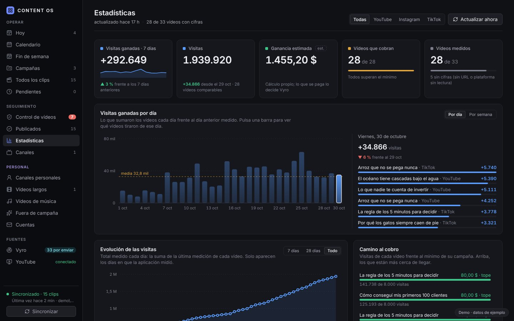
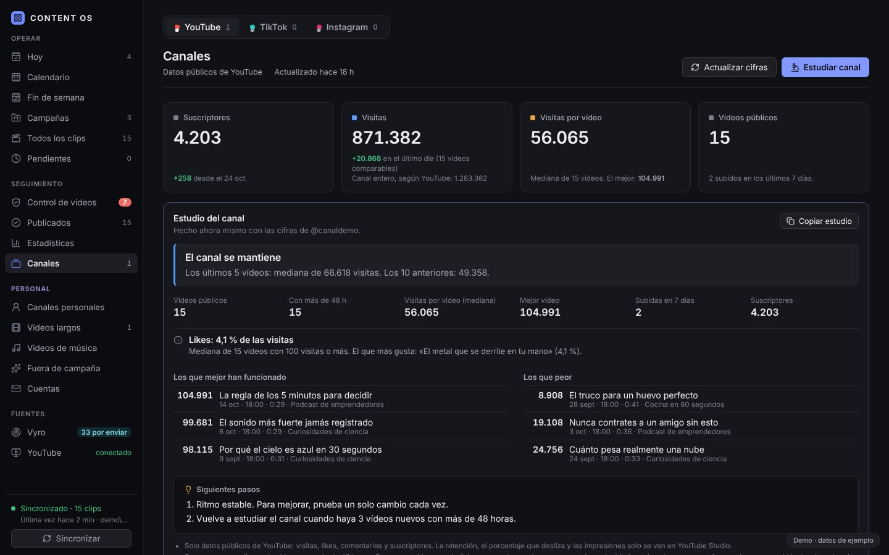
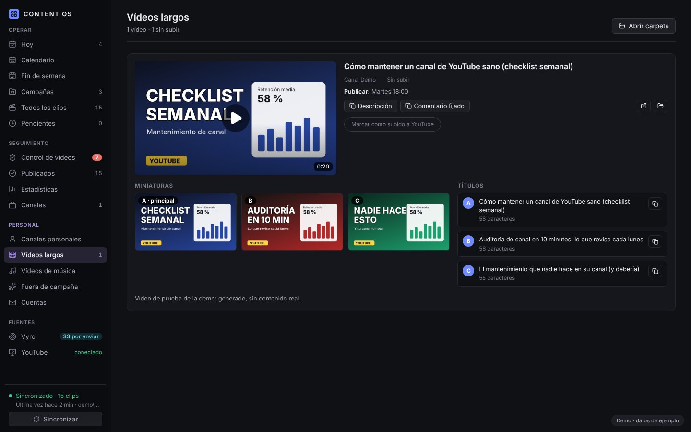
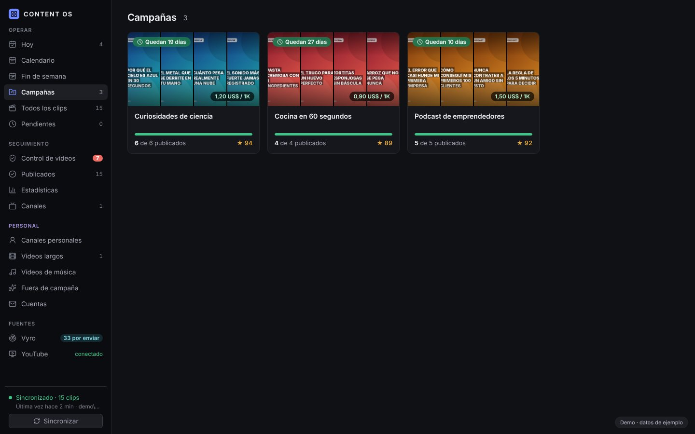
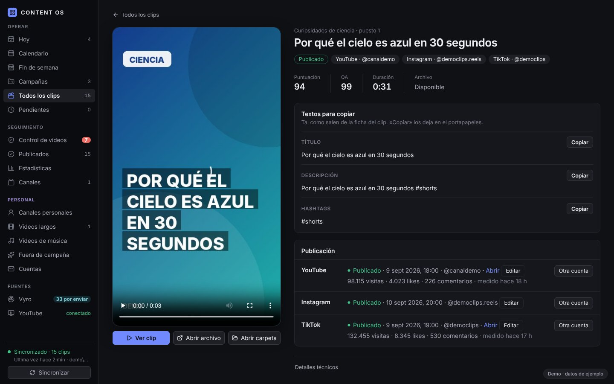

# CONTENT OS

App de escritorio para **automatizar la gestión de una operación de clips cortos**: importa los vídeos que genera un pipeline propio (`mundial-clipper`), planifica qué publicar en cada canal de TikTok, YouTube e Instagram, registra las publicaciones y mide sus estadísticas, y lleva las cuentas de las campañas de clipping.

> **Vyro** es una plataforma de *clipping*: marcas, podcasts y creadores publican campañas y pagan por cada 1.000 visitas que consiguen los clips en TikTok, YouTube Shorts o Instagram Reels (con un mínimo de visitas y un tope por vídeo). CONTENT OS lee su lista pública de campañas, avisa de las nuevas y calcula qué falta por enviar y cuánto se ha ganado.

Hecha con IA aplicada (Claude Code) como herramienta de trabajo diaria.

**Stack:** Electron · React 19 · TypeScript · SQLite (better-sqlite3) · Vite · Vitest (~290 tests)

**▶ Demo en vivo:** https://juangadi7.github.io/content-os/ — la interfaz real con un canal de ejemplo y 60 días de estadísticas inventadas.



> Este repositorio es una copia pública del código: los nombres de canales y los identificadores reales se han sustituido por valores de ejemplo y no incluye datos, capturas ni credenciales. Las claves de las APIs se guardan cifradas en local en tiempo de ejecución (`src/main/secrets.ts`), nunca en el código.

## Qué hace

- **Importador de solo lectura**: lee las carpetas de campañas y las vuelca en SQLite sin escribir nunca en ellas.
- **Plan de publicación**: reparte los clips entre canales y plataformas, con calendario y vista de fin de semana.
- **Publicaciones y estadísticas**: guarda cada subida y mide visualizaciones (YouTube Data API, TikTok, Instagram Graph API), con series temporales y gráficas.
- **Campañas y dinero**: estado de las campañas de Vyro, envíos pendientes, pedidos y libro de cuentas.
- **Limpieza de material en bruto**: calcula lo que ocupan los vídeos fuente y libera espacio de forma segura.

## Capturas

| Estudio del canal | Vídeos largos |
|---|---|
|  |  |
| **Campañas** | **Ficha de un clip** |
|  |  |

## Demo web

La aplicación es de escritorio, así que la demo es la misma interfaz (`src/renderer`) compilada para el navegador, con `window.contentOS` sustituido por respuestas guardadas (`src/renderer/demo-api.ts`). Esas respuestas las genera `demo/build-data.ts` ejecutando **la lógica real de la app** (importador, publicaciones, sincronización de canales con una API de YouTube simulada) sobre una base de datos temporal. Las portadas, miniaturas y el vídeo largo de prueba se dibujan con `demo/make_media.py`; no hay material de terceros.

```bash
npm run demo        # datos + imágenes + build en demo/dist
```

## Detalles técnicos

Aplicación local de escritorio (Windows). Solo **lee** las carpetas de campañas; sus datos propios viven en
`%APPDATA%\ContentOS\`.

## Comandos

| Comando | Qué hace |
|---|---|
| `npm run dev` | Arranca la aplicación en desarrollo (recarga en caliente) |
| `npm run build` | Compila a `out\` |
| `npm start` | Arranca la versión compilada |
| `npm test` | Pruebas del importador con campañas de ejemplo aisladas |
| `npm run test:real` | Sync de solo lectura contra las campañas reales, con base de datos temporal y comprobación de que `CAMPAIGNS` no cambia |
| `npm run typecheck` | Comprobación de tipos |

Las pruebas se ejecutan dentro del runtime de Electron (`scripts/run-tests.cjs`), es decir, con
el mismo SQLite que usa la aplicación.

## Estructura

```
src/core      dominio: esquema, importador, lectura de campañas, consultas (sin Electron)
src/main      proceso principal: ventana, datos, IPC
src/preload   única API expuesta a la interfaz (window.contentOS)
src/renderer  interfaz React
tests         pruebas del importador; tests/fixtures construye campañas de ejemplo
```

## Datos

```
%APPDATA%\ContentOS\
  content-os.db          base de datos SQLite propia
  config\config.json     bibliotecas ("library_roots"), editable
  thumbs\                copias de las portadas
  backups\               copia de la base antes de cada cambio de esquema
  electron\              archivos internos de Chromium
```

## Regla de oro

`CAMPAIGNS -> lectura -> importador -> SQLite -> interfaz`. Nunca al revés: CONTENT OS no
escribe dentro de las bibliotecas ni crea identidades; un clip es su `clip_id`.

## Licencia

MIT
